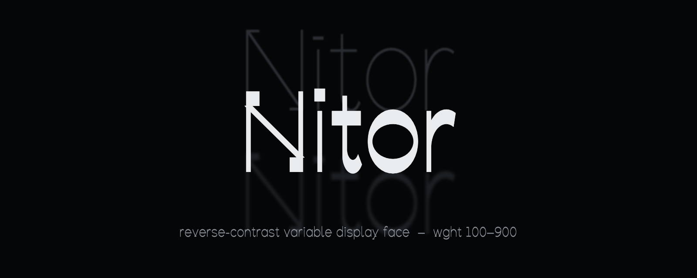
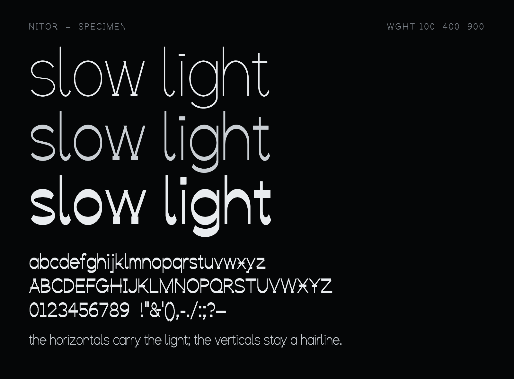
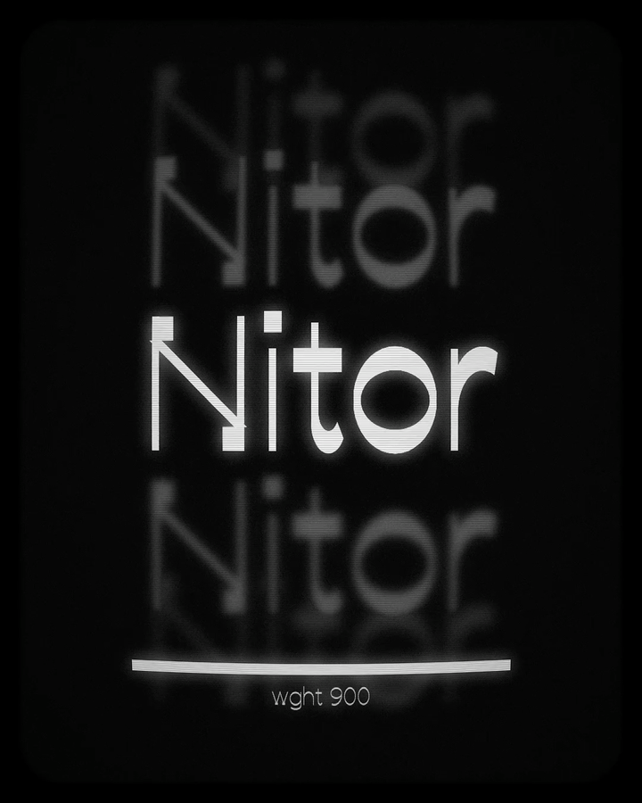

# Nitor



Nitor is a reverse-contrast variable display face. The usual stress is
inverted: the verticals are hairlines and the horizontals carry the weight.
Wherever strokes meet or bottom out, a horizontal band sits there, so as the
weight increases the letters build up like stacked scanlines.

Status: **the fonts, their build source and the font documentation are
licensed under the SIL Open Font License 1.1, with Reserved Font Name "Nitor". The specimen images and
video are not licensed. This repository is private and not publicly
released.** See [LICENSE](LICENSE) and [OFL.txt](OFL.txt).



## Axis

| Axis | Tag | Range | Default |
|---|---|---|---|
| Weight | `wght` | 100 to 900 | 100 (Thin) |

Named instances: Thin (100), Regular (400), Black (900). The default
instance is the thinnest end of the axis, so set a weight explicitly when you
use the variable font. Across the axis the horizontals grow much more than the
verticals: the horizontal stroke goes from 22 to 132 units, the vertical stroke
from 18 to 40.

## Character coverage

78 glyphs, 77 mapped characters:

- Lowercase `a`–`z`
- Uppercase `A`–`Z`
- Figures `0`–`9`
- Space and `! " & ' ( ) , - . / : ; ?` plus the en dash `–`

Known gaps: no accented or non-Latin letters; no `# $ % * + < = > @ [ \ ] ^ _ { | } ~` or backtick; no curly quotes or em dash. The fonts are unhinted
and keep overlapping contours, and kerning covers only the 91 letter pairs
that would otherwise touch.

## Fonts

| File | What it is |
|---|---|
| [`fonts/variable/Nitor-VF.ttf`](fonts/variable/Nitor-VF.ttf) | Variable font, `wght` 100–900 |
| [`fonts/static/Nitor-Thin.ttf`](fonts/static/Nitor-Thin.ttf) | Static, weight 100 |
| [`fonts/static/Nitor-Regular.ttf`](fonts/static/Nitor-Regular.ttf) | Static, weight 400 |
| [`fonts/static/Nitor-Black.ttf`](fonts/static/Nitor-Black.ttf) | Static, weight 900 |
| [`fonts/webfonts/`](fonts/webfonts/) | WOFF versions of all four, for the web |

The web fonts are WOFF, not WOFF2: WOFF2 needs the Brotli compressor, which
is not part of the toolchain used here. Each WOFF holds exactly the same
tables as its TTF.

## Installing

The fonts are licensed under the SIL Open Font License 1.1 (see
[OFL.txt](OFL.txt)), which allows installing and embedding them.

- **macOS:** double-click a `.ttf` file and choose *Install Font* in Font Book.
- **Windows:** right-click a `.ttf` file and choose *Install*.
- **Linux:** copy the `.ttf` files to `~/.local/share/fonts/` and run `fc-cache -f`.

Install either the variable font or the static fonts, not both, to avoid
duplicate names in font menus.

## Using it on the web

```css
@font-face {
  font-family: "Nitor";
  src: url("fonts/webfonts/Nitor-VF.woff") format("woff"),
       url("fonts/variable/Nitor-VF.ttf") format("truetype");
  font-weight: 100 900;
  font-display: swap;
}

h1 {
  font-family: "Nitor", sans-serif;
  font-weight: 900;      /* any value from 100 to 900 */
}
```

Paths are relative to this repository; adjust them to wherever you serve the
files from.

## Specimen video

[`video/Nitor-specimen.mp4`](video/Nitor-specimen.mp4): 24.5 seconds,
1080 × 1350, 30 fps, silent, 18.5 MB. Only the virtual camera and the real
weight axis move; the letters are the font itself. The video and the specimen
images are not covered by the font licence.



## Building from source

Requirements: Python 3.11 with fontTools 4.39.4 and Pillow 9.5.0, and macOS
Swift (AVFoundation) for the video. Run from the repository root:

```sh
P=python3.11   # the Python that has fontTools and Pillow

# fonts
$P -B drift1/build.py          # draws both masters, builds the variable font
$P -B drift1/rc1.py            # adds collision kerning and runs QA
$P -B drift1/rc2.py            # applies the ampersand fix, same kerning
$P -B nitor/build_nitor.py     # sets names and licence metadata -> nitor/out/fonts/

# web fonts (WOFF, same tables as the TTFs)
$P -B -c "
from fontTools.ttLib import TTFont
for n in ('VF', 'Thin', 'Regular', 'Black'):
    f = TTFont(f'nitor/out/fonts/Nitor-{n}.ttf', recalcTimestamp=False)
    f.flavor = 'woff'
    f.save(f'nitor/out/fonts/Nitor-{n}.woff', reorderTables=False)"

# specimen video (frames go to any scratch folder)
$P -B nitor/video/make_frames_nitor.py nitor/out/fonts/Nitor-VF.ttf FRAMES_DIR nitor/out/video/frame-qa.json
swift nitor/video/encode.swift encode FRAMES_DIR 735 30 nitor/out/video/Nitor-specimen.mp4 6000000
```

The build steps write to fixed output paths and stamp the build time into
each font's `head` table, so a rebuild matches the files here table for table
except for the created and modified times (and the checksum that covers them). The font drawing code is in
[`drift1/glyphs.py`](drift1/glyphs.py); see [`nitor/README.md`](nitor/README.md)
for more detail on the naming step.

## Design notes

See [DESIGN.md](DESIGN.md). The earlier rounds of this project, before Nitor's
direction was chosen, are kept in [`stage0/`](stage0/), [`r4/`](r4/) and
[`diag/`](diag/).

## Name

*Nitor* is Latin for brightness or sheen.

## Licence

Copyright (c) 2026, Karan Kapur, with Reserved Font Name "Nitor".

- **Fonts** (`fonts/`), **font build source** (`drift1/glyphs.py`,
  `drift1/build.py`, `drift1/rc1.py`, `drift1/rc2.py`, `nitor/build_nitor.py`)
  and **font documentation** (this README, `DESIGN.md`, `nitor/README.md`):
  SIL Open Font License, Version 1.1. See [OFL.txt](OFL.txt).
- **Specimen images** (`images/`), **specimen video** (`video/`, made by
  `nitor/video/`) and everything else in this repository: not licensed; no
  permission is granted.

The full scope is in [LICENSE](LICENSE). The copyright notice states the
claimed holder; it is not a certification of legal ownership.
